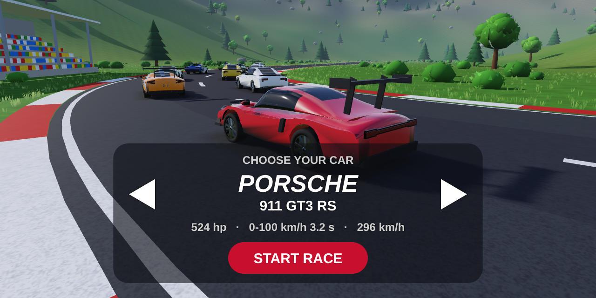
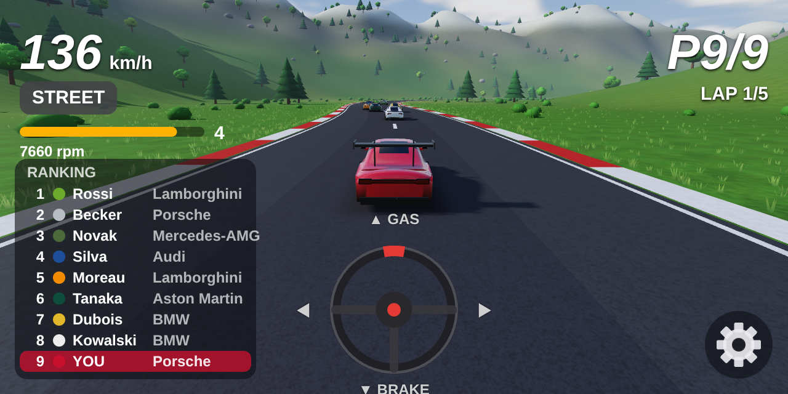
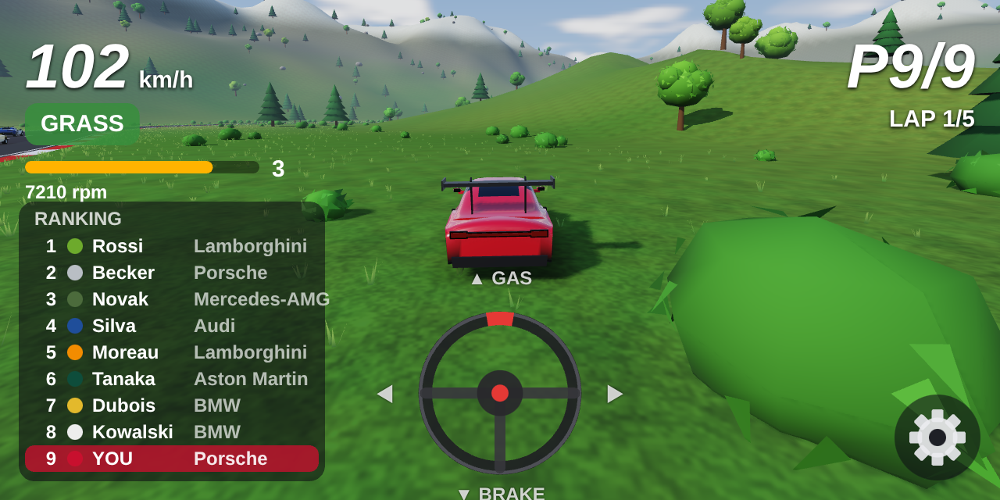
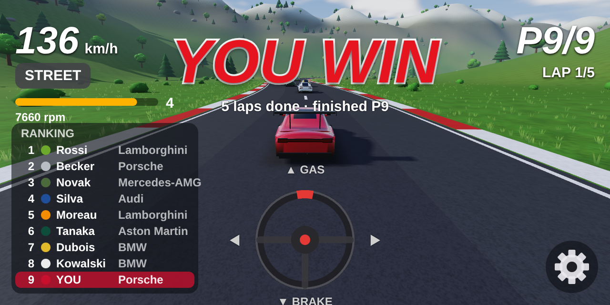
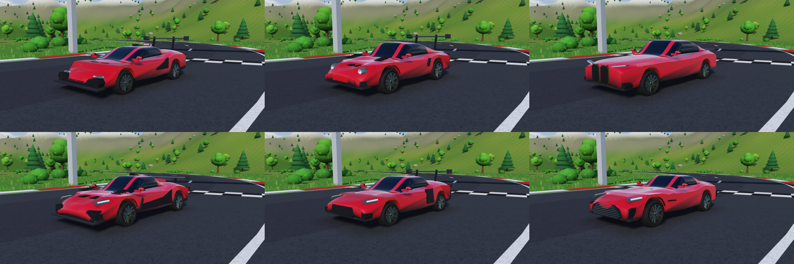
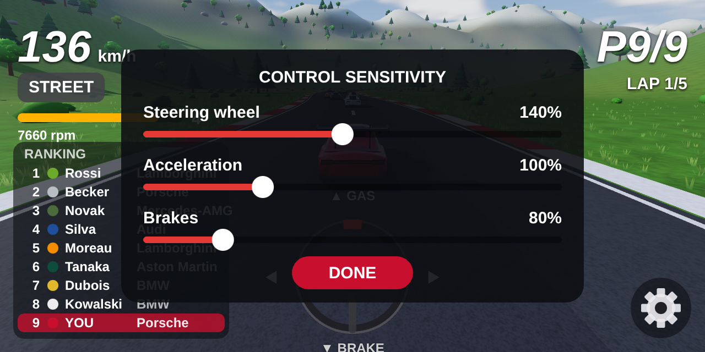

# Race Game

A small 3D racing game for Android. Pick a sports car, then race 8 opponents over 5 laps on a
track through grass, woods and hills, seen from a chase camera behind the car.








<sub>Screenshots are rendered from the game's own assets with WebGL 2 in headless Chromium (see
`tools/preview`), with shaders that approximate Filament's lighting; on the phone Filament renders
them. The steering wheel and HUD in them are an approximation of the Android overlay.</sub>

## Cars

Before the race you choose your car with the arrows and press **START RACE**. Six models, styled
after real cars (proportions from published dimensions, brand names only, no logos):

| Car | Power | Weight | 0-100 km/h | Top speed | Drive | Tires front / rear |
|---|---|---|---|---|---|---|
| Lamborghini Huracán EVO | 639 hp | 1550 kg | 2.9 s | 325 km/h | AWD | 245/30 R20 / 305/30 R20 |
| Porsche 911 GT3 RS | 525 hp | 1450 kg | 3.2 s | 296 km/h | RWD | 275/35 R20 / 335/30 R21 |
| BMW M4 Competition | 530 hp | 1775 kg | 3.5 s | 290 km/h | AWD | 275/35 R19 / 285/30 R20 |
| Mercedes-AMG ONE | 1063 hp | 1695 kg | 2.9 s | 352 km/h | AWD | 285/35 R19 / 335/30 R20 |
| Audi R8 V10 performance | 620 hp | 1595 kg | 3.1 s | 331 km/h | AWD | 245/30 R20 / 305/30 R20 |
| Aston Martin Vantage | 665 hp | 1605 kg | 3.5 s | 325 km/h | RWD | 275/35 R21 / 325/30 R21 |

The physics take these figures over directly. Engine power (minus drivetrain losses) is limited by
tire traction at low speed; air drag is solved from the top speed and launch traction from the
0-100 time, so every car reaches its published numbers (checked by the unit tests). Braking,
cornering grip and downforce differ per car, and turning follows the wheelbase and steering angle.

## Race

You race 8 AI opponents, each driving one of the six models, starting from the back of the grid
after a 3-2-1 countdown. Each opponent has its own skill level and preferred line, brakes for
corners according to its own car's grip, and swings out to overtake slower cars.

The **ranking** in the bottom-left corner shows the live order with each driver's car brand.
Crossing the finish line **5 times** completes the race: a red **YOU WIN** pops up above your car,
with your finishing place. Tap anywhere to pick a car and race again.

## Controls

A steering wheel sits at the bottom of the screen. Touch it and drag:

- **left / right**: steer
- **up**: accelerate (the further up, the more throttle)
- **down**: brake; keep holding it while stopped to reverse
- **let go**: the wheel re-centers and the car coasts

The **gear button** in the bottom-right corner opens sliders for the sensitivity of the steering
wheel, the accelerator and the brakes (40-250%: higher means less finger travel for full lock,
full throttle or full braking). The settings are saved on the phone.

The ground matters. On **grass** the tires have under half the grip of asphalt, so the car
accelerates, steers and brakes much more slowly. Tire size counts there: wider tires bite better
but plough more, bigger wheels roll over the bumps more easily, and four driven wheels help.
Floor the throttle on grass and the tires spin, which pushes the car less than gripping tires:
easing off accelerates harder, and the more horsepower, the sooner the wheels spin. Top speed on
grass is about 95-140 km/h depending on the car. On asphalt, traction control keeps the tires
gripping (`Surface`, `Tyre` and `CarSpec.driveAccel` in `CarPhysics.kt`).
On asphalt a car stops from 100 km/h in about 30 m.
The HUD shows speed, the current ground type, position, lap and lap times.

## Engine sound

Each car has its engine layout (Lamborghini and Audi V10, Porsche flat-six, BMW inline-six,
Mercedes-AMG ONE hybrid V6 revving to 11,000 rpm, Aston Martin V8), its redline and number of gears. An automatic gearbox shifts
up near the redline and down as you slow; the HUD shows a rev bar, rpm and gear. The sound is
synthesized live from engine speed, throttle and layout (no recordings): the firing frequency and
its harmonics give the pitch, a V8 gets its uneven-firing burble, throttle adds roar, and shifts
cut in briefly. `gradle sound` in `tools/preview` renders a full-throttle run of each car to WAV.

## Graphics

Rendering uses [Filament](https://github.com/google/filament), Google's physically based
rendering engine, on its **Vulkan** backend (phones without Vulkan 1.1 fall back to OpenGL ES 3).
Lighting is physically based in physical light units: a sun with cascaded soft shadows, an HDR
sky that lights the scene (spherical harmonics) and reflects in paint and glass, clear-coated
paint, chrome, textured grass and asphalt, screen-space ambient occlusion, bloom, height fog
colored by the sky, glowing brake lights, 4x MSAA, dynamic resolution on slower phones and filmic
tone mapping. The world and cars are generated in code as glTF, which Filament's glTF loader
reads like any other model.

### Real car models

The cars are procedural look-alikes. Real manufacturer models can't be shipped in this repo:
the ones you find online (Sketchfab, game rips) are almost always under licenses that forbid
redistribution, and brand designs are protected. If you have a model you're allowed to use,
put it in the app as glTF binary and it replaces the generated body:

| File | Replaces |
|---|---|
| `app/src/main/assets/models/cars/lambo.glb` | Lamborghini |
| `app/src/main/assets/models/cars/911.glb` | Porsche |
| `app/src/main/assets/models/cars/m4.glb` | BMW |
| `app/src/main/assets/models/cars/amggt.glb` | Mercedes-AMG |
| `app/src/main/assets/models/cars/r8.glb` | Audi |
| `app/src/main/assets/models/cars/vantage.glb` | Aston Martin |

The model should be in meters, nose towards +Z, Y up, origin on the ground under the car's
center. It brings its own wheels (the generated ones are hidden), and every material with
"paint" in its name gets the driver's color. The renderer reads positions, normals, vertex
colors, base color textures and metallic/roughness/clear-coat/emission values; normal and
roughness maps are ignored.

## Tech

Kotlin, with Filament (Vulkan) for rendering and no game engine. All geometry (terrain, track, trees,
grandstand, cars) is generated in code, including ~30,000 grass tufts along the verges and
individual leaves on the broadleaf trees and bushes (`SceneMeshes.foliage`).

| File | What it does |
|---|---|
| `MainActivity.kt` | Fullscreen landscape activity: render surface + control overlay |
| `ControlOverlayView.kt` | Steering wheel touch control, car picker and HUD |
| `FilamentRenderer.kt` | Filament on Vulkan: sun, sky, shadows, post-processing, glTF assets; frame loop |
| `GameLoop.kt` | Steps the simulation each frame and publishes HUD values |
| `Scene.kt` | Assets, chase camera, shadow cascades and per-frame car/wheel transforms |
| `Glb.kt` | Writes the procedural meshes as glTF with PBR materials and detail textures |
| `SkyEnvironment.kt` | Procedural HDR sky: skybox, reflections and diffuse light |
| `GameState.kt` | Race simulation: car choice, AI drivers, grid and countdown, collisions, laps, ranking |
| `CarPhysics.kt` | Real car specs, vehicle dynamics, gearbox, street/grass parameters |
| `EngineSound.kt` | Engine sound synthesis and audio streaming |
| `World.kt`, `Track.kt` | Track shape, hills, trees, bushes, rocks, grandstand |
| `CarModel.kt` | The six car styles: lofted bodies with wheel arches, grilles, lights, wings, exhausts |
| `SceneMeshes.kt`, `MeshBuilder.kt` | Procedural world meshes and mesh helpers |

## Build and install

Every push builds the APK on GitHub Actions: open the latest **Android build** run
under the Actions tab and download the `racegame-debug-apk` artifact, then unzip it
and install `app-debug.apk` on your phone (allow installs from unknown sources).

Locally, with the Android SDK installed (or from Android Studio):

```sh
./gradlew assembleDebug          # app/build/outputs/apk/debug/app-debug.apk
./gradlew installDebug           # install on a connected device
./gradlew testDebugUnitTest      # gameplay unit tests
```

Requires Android 7.0 (API 24) or newer.
