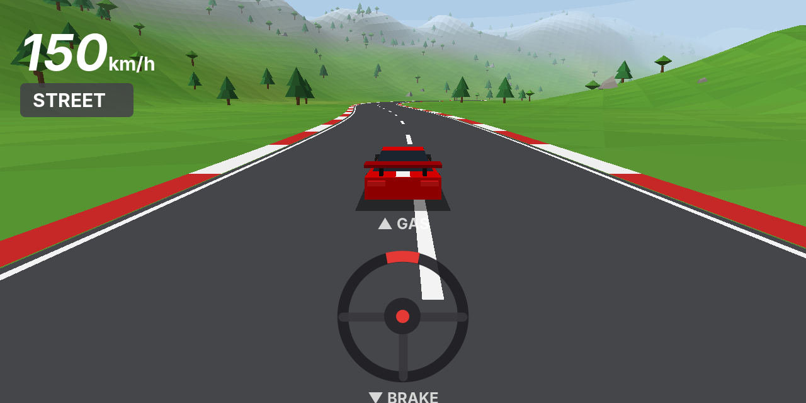
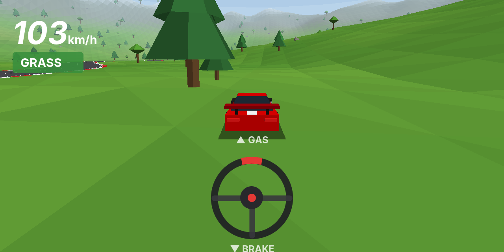

# Race Game

A small 3D racing game for Android. Drive a red sports car around a track through
grass, woods and hills, seen from a chase camera behind the car.




<sub>Previews are offline software renders of the same scene; the in-game wheel is drawn with Android's Canvas.</sub>

## Controls

A steering wheel sits at the bottom of the screen. Touch it and drag:

- **left / right**: steer
- **up**: accelerate (the further up, the more throttle)
- **down**: brake; keep holding it while stopped to reverse
- **let go**: the wheel re-centers and the car coasts

The ground matters. On **grass** the car accelerates, steers and brakes much more
slowly than on the **street**, and its top speed is lower:

| | Street | Grass |
|---|---|---|
| Acceleration | 11 m/s² | 4.5 m/s² |
| Top speed | ~210 km/h | ~86 km/h |
| Braking | 24 m/s² | 9 m/s² |
| Max steering rate | 1.5 rad/s | 0.75 rad/s |

These live in `Surface.STREET` / `Surface.GRASS` in `CarPhysics.kt`.
The HUD shows speed, the current ground type and lap times.

## Tech

Plain Kotlin with OpenGL ES 2.0 (`GLSurfaceView`), no game engine and no third-party
libraries. All geometry (terrain, track, trees, car) is generated in code.

| File | What it does |
|---|---|
| `MainActivity.kt` | Fullscreen landscape activity, GL view + control overlay |
| `ControlOverlayView.kt` | Steering wheel touch control and HUD |
| `GameRenderer.kt` | GL render loop, chase camera, drawing |
| `GameState.kt` | Simulation: ground detection, tree collisions, laps |
| `CarPhysics.kt` | Car model and street/grass parameters |
| `World.kt`, `Track.kt` | Track shape, hills, tree and rock placement |
| `SceneMeshes.kt`, `MeshBuilder.kt` | Procedural meshes |

## Build and install

Every push builds the APK on GitHub Actions: open the latest **Android build** run
under the Actions tab and download the `racegame-debug-apk` artifact, then unzip it
and install `app-debug.apk` on your phone (allow installs from unknown sources).

Locally, with the Android SDK installed (or from Android Studio):

```sh
./gradlew assembleDebug          # app/build/outputs/apk/debug/app-debug.apk
./gradlew installDebug           # install on a connected device
./gradlew testDebugUnitTest      # gameplay unit tests
```

Requires Android 7.0 (API 24) or newer.
